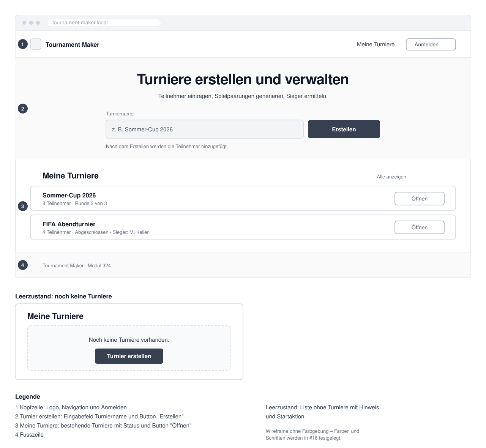
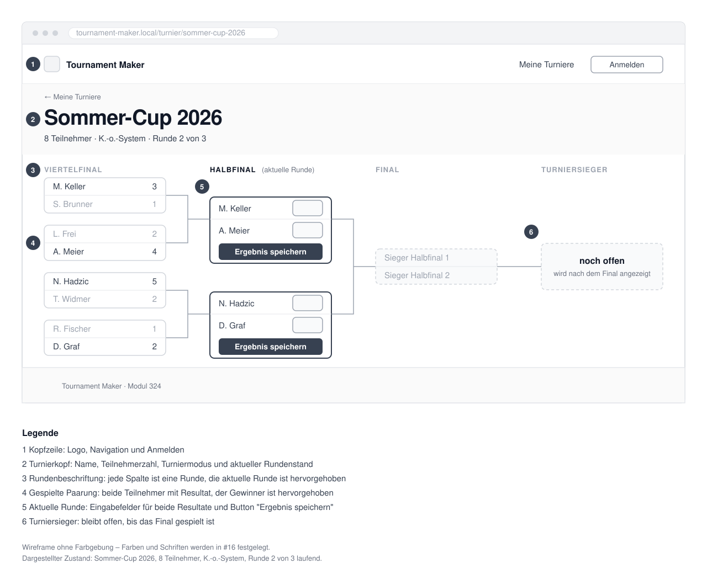

# Mockups

Übersicht über alle Entwürfe der Benutzeroberfläche (Epic [#7](https://github.com/hadzicni/modul-324-project/issues/7)).

Die Mockups sind Wireframes ohne Farbgebung. Farben und Schriften werden separat in
[#16](https://github.com/hadzicni/modul-324-project/issues/16) festgelegt.

## Übersicht

| Mockup      | Issue                                                          | Datei                                  | Design-Datei                                                                                                      |
| ----------- | -------------------------------------------------------------- | -------------------------------------- | ----------------------------------------------------------------------------------------------------------------- |
| Startseite  | [#14](https://github.com/hadzicni/modul-324-project/issues/14) | [`startseite.svg`](./startseite.svg)   | –                                                                                                                 |
| Turnierbaum | [#15](https://github.com/hadzicni/modul-324-project/issues/15) | [`turnierbaum.svg`](./turnierbaum.svg) | [Figma: Tournament Maker – Mockup](https://www.figma.com/design/5oPhboOAlBERrE2ORYvVPK/Tournament-Maker---Mockup) |

## Startseite

Einstiegsseite mit Turnierübersicht und dem Einstieg zum Erstellen eines neuen Turniers.

## Turnierbaum

Darstellung eines laufenden K.-o.-Turniers über alle Runden hinweg.

- Jede Spalte ist eine Runde (Viertelfinal, Halbfinal, Final, Turniersieger).
- Gespielte Paarungen zeigen beide Teilnehmer mit Resultat, der Gewinner ist hervorgehoben.
- Die aktuelle Runde ist hervorgehoben und enthält die Eingabefelder für die Resultate
  sowie den Button "Ergebnis speichern".
- Noch nicht gespielte Runden und der Turniersieger werden als Platzhalter dargestellt.

## Konventionen

- Format: SVG, Breite 1280 px, Graustufen.
- Nummerierte Marker im Mockup werden unterhalb in einer Legende erklärt.
- Die Mockups liegen in diesem Ordner und sind zusätzlich über die verlinkte Design-Datei einsehbar.
